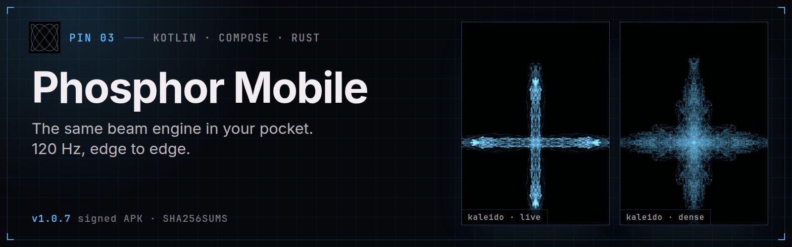
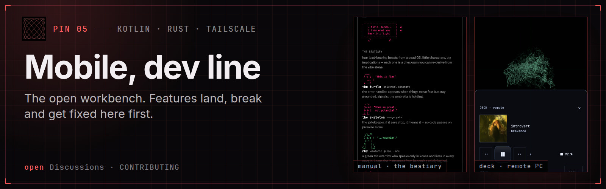

  

  <b>Ben · RamenFast</b> 
  Instruments for people, and interfaces an agent can read. 
  Linux · Rust · Kotlin · Zig · GPLv3 by default

The name above is not a font. It is a two-second stereo file, [`ramenfast.wav`](assets/ramenfast.wav): the left channel moves the beam across and the right channel moves it up. [Phosphor](https://github.com/RamenFast/phosphor) drew it, and every other image on this page came out of the [same pipeline](art/).

## Pinned, on purpose

Six pins, in the order I set them. Each one earns its place for a reason.

**Why it's first:** everything else on this page grew out of this one. One Rust engine, a native PipeWire graph, and a beam that behaves like a real P7 tube. It has a full agent surface too: `probe`, `ctl`, `tap` and `schema` over a control socket.
[Repo](https://github.com/RamenFast/phosphor) · [Releases](https://github.com/RamenFast/phosphor/releases) · [Drawn by sound](https://github.com/RamenFast/phosphor#drawn-by-sound)

**Why it's pinned:** agent memory should be something you can see and correct, not a black box. The Eye draws the memory's real geometry, and edits are journaled and undoable. Its icon was drawn by Phosphor.
[Repo](https://github.com/RamenFast/holographic-eye) · [Releases](https://github.com/RamenFast/holographic-eye/releases) · [Agent interface](https://github.com/RamenFast/holographic-eye/blob/master/docs/AGENT-INTERFACE.md)

**Why it's pinned:** the stable Android release. It runs the same Rust beam crates as the desktop, not an imitation of them. Signed APK with checksums, no account, no tracking.
[Repo](https://github.com/RamenFast/phosphor-mobil3) · [Signed APK](https://github.com/RamenFast/phosphor-mobil3/releases/latest)

**Why it's pinned:** the lab notebook. A 27B model running on a mainstream Radeon with no ROCm, measured, with receipts. It includes an honesty ledger of what did not work.
[Repo](https://github.com/RamenFast/bonsai27b-vulkan) · [Measurements](https://github.com/RamenFast/bonsai27b-vulkan/blob/main/docs/DETAILS.md) · [Agent setup](https://github.com/RamenFast/bonsai27b-vulkan/blob/main/docs/AGENT-SETUP.md)

**Why it gets its own pin:** this is the door to walk through if you want to help. Experiments land here first: the PC relay over Tailscale, geometry effects, the in-app bestiary. Discussions are open.
[Repo](https://github.com/RamenFast/phosphor-mobil3-dev) · [Contributing](https://github.com/RamenFast/phosphor-mobil3-dev/blob/master/CONTRIBUTING.md) · [Discussions](https://github.com/RamenFast/phosphor-mobil3-dev/discussions)

**Why it's pinned:** the same contract, in its plainest form. The window you look at and the JSON an agent reads come from one engine. The reading on the plate is real output from my desk.
[Repo](https://github.com/RamenFast/sysmon) · [Releases](https://github.com/RamenFast/sysmon/releases) · [Agent guide](https://github.com/RamenFast/sysmon/blob/main/docs/AGENTS.md)

## What ties them together

- **Two front doors, one engine.** A window for your eyes, and a contract for an agent: `probe`, `ctl`, `schema`, and errors that name their own fix.
- **Receipts over adjectives.** Numbers come with the machine and the date they were measured.
- **Yours, locally.** GPLv3, no accounts, no tracking. Releases ship with checksums.

## Also in the workshop

- **[Concourse](https://github.com/RamenFast/concourse)**, one hall for the station's tools, with a GUI and a CLI over one core.
- **[Intercom](https://github.com/RamenFast/intercom)**, local speech in and out through Piper and whisper.cpp.
- **[SymbolOS](https://github.com/RamenFast/SymbolOS)**, where the context lives between projects: shared symbols, reading paths and characters. The [archive](https://github.com/RamenFast/SymbolOS_archive) keeps the old photograph.

Other doors

- **[Blossom](https://github.com/RamenFast/Blossom)**, a true-black desktop theme, plus its **[shell companion](https://github.com/RamenFast/blossom-shell)**.
- **[iPhone 4S retro](https://github.com/RamenFast/iphone4s-retro)**, notes on reviving a family phone as a retro player, entirely from Linux.
- **[Zenfone 9 research](https://github.com/RamenFast/zenfone9-root)**, device research and documentation.

---

Mercer carries the lantern. Rhy asks the awkward question. The turtle keeps us honest about the next small step. ☂

Every image here rebuilds with one command: [`art/build.sh`](art/). · [GitHub field guide](docs/GITHUB-GUIDE.md)
