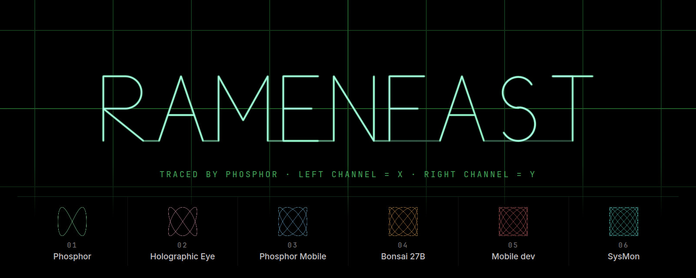
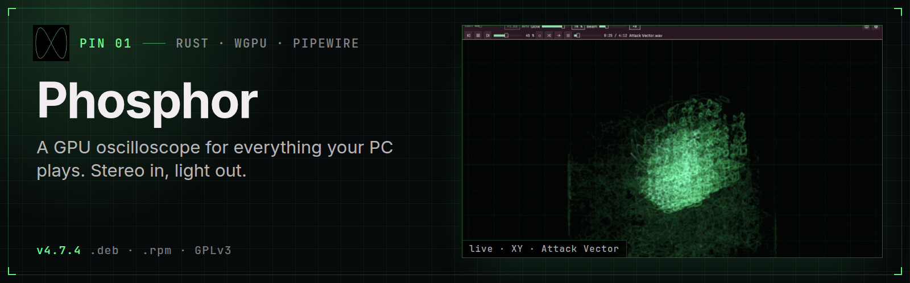
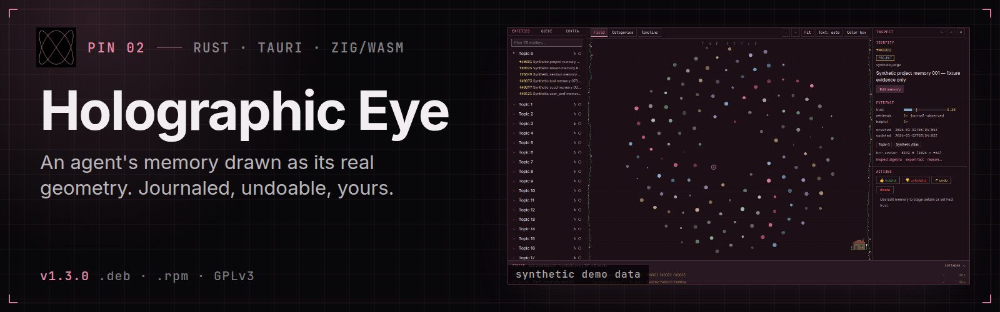
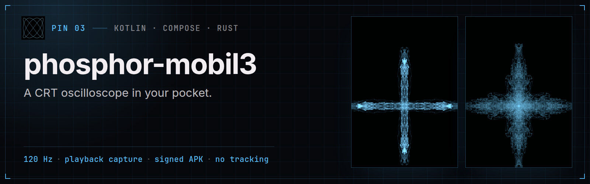
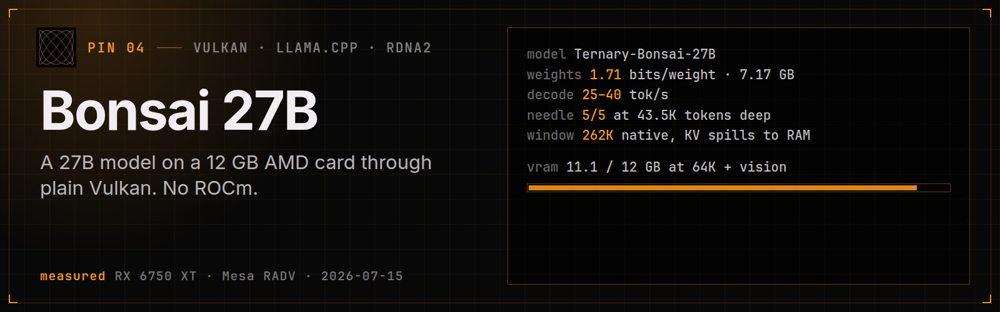
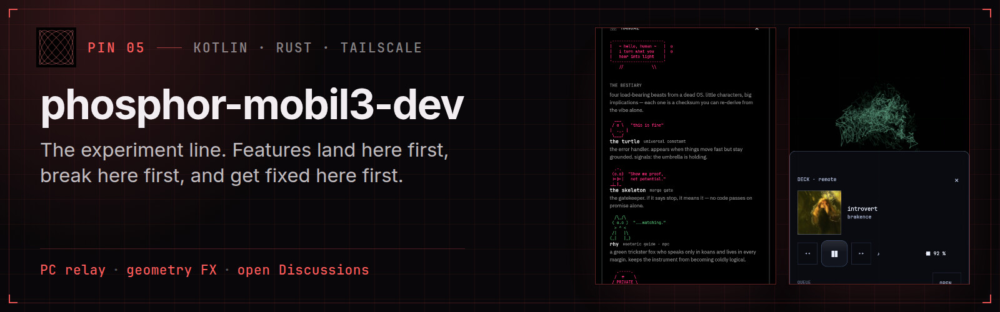
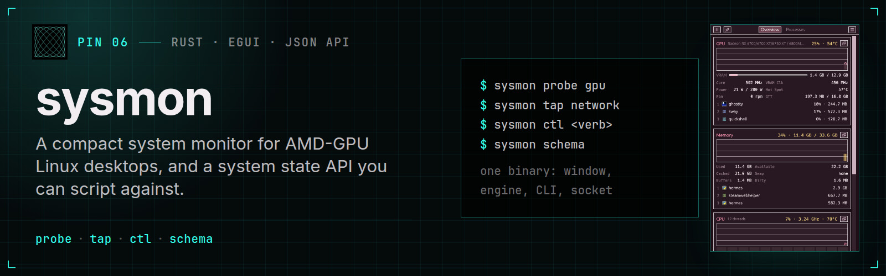

  

  <b>Ben · RamenFast</b> 
  Eyes that see and ears that hear, for agents and people alike. 
  Senior vibe systems architect · Linux · Rust · Kotlin · Zig · GPLv3 by default

The name above is a two-second stereo file, [`ramenfast.wav`](assets/ramenfast.wav), drawn by [phosphor](https://github.com/RamenFast/phosphor).

🔭 [phosphor](https://github.com/RamenFast/phosphor) · 📦 [releases](https://github.com/RamenFast/phosphor/releases) · 🎨 [drawn by sound](https://github.com/RamenFast/phosphor#drawn-by-sound) · 🤖 [agents](https://github.com/RamenFast/phosphor/blob/master/docs/AGENTS.md)

👁️ [holographic-eye](https://github.com/RamenFast/holographic-eye) · 📦 [releases](https://github.com/RamenFast/holographic-eye/releases) · 🤖 [agent interface](https://github.com/RamenFast/holographic-eye/blob/master/docs/AGENT-INTERFACE.md)

📱 [phosphor-mobil3](https://github.com/RamenFast/phosphor-mobil3) · 📦 [signed APK](https://github.com/RamenFast/phosphor-mobil3/releases/latest) · 🛰️ [remote](https://github.com/RamenFast/phosphor-mobil3/blob/main/docs/REMOTE.md)

🌱 [bonsai27b-vulkan](https://github.com/RamenFast/bonsai27b-vulkan) · 📏 [measurements](https://github.com/RamenFast/bonsai27b-vulkan/blob/main/docs/DETAILS.md) · 🧾 [receipts](https://github.com/RamenFast/bonsai27b-vulkan/blob/main/docs/dev/RECEIPTS.md) · 🤖 [agent setup](https://github.com/RamenFast/bonsai27b-vulkan/blob/main/docs/AGENT-SETUP.md)

🧪 [phosphor-mobil3-dev](https://github.com/RamenFast/phosphor-mobil3-dev) · 🤝 [contributing](https://github.com/RamenFast/phosphor-mobil3-dev/blob/master/CONTRIBUTING.md) · 💬 [discussions](https://github.com/RamenFast/phosphor-mobil3-dev/discussions)

📊 [sysmon](https://github.com/RamenFast/sysmon) · 📦 [releases](https://github.com/RamenFast/sysmon/releases) · 🤖 [agents](https://github.com/RamenFast/sysmon/blob/main/docs/AGENTS.md)

## 🧰 Also in the workshop

- 🏛️ **[concourse](https://github.com/RamenFast/concourse)** · one hall for the station's tools, GUI and CLI over one core
- 🎙️ **[intercom](https://github.com/RamenFast/intercom)** · local speech in and out, Piper and whisper.cpp
- ☂️ **[SymbolOS](https://github.com/RamenFast/SymbolOS)** · the living contextual OS of the station. Its photograph: **[SymbolOS_archive](https://github.com/RamenFast/SymbolOS_archive)**

More repos

- 🌸 **[Blossom](https://github.com/RamenFast/Blossom)** · true-black desktop theme, with **[blossom-shell](https://github.com/RamenFast/blossom-shell)**
- 📼 **[iphone4s-retro](https://github.com/RamenFast/iphone4s-retro)** · a family iPhone 4S as a retro media player, entirely from Linux
- 🔬 **[zenfone9-root](https://github.com/RamenFast/zenfone9-root)** · device research on the ASUS Zenfone 9

---

Mercer carries the lantern. Rhy asks the awkward question. The turtle keeps us honest about the next small step. ☂
