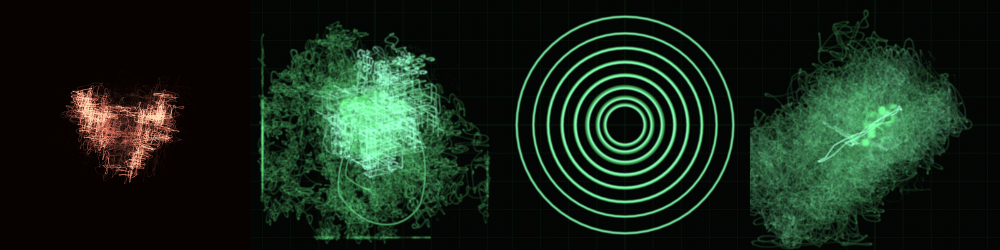

<p align="center">
  
</p>

# Ben / RamenFast

**Sound into light. Tools you can talk to.**

I build on Linux, mostly in Rust, Zig and Kotlin. I like instruments you can explore with your hands, and interfaces an agent can use without guessing at pixels.

```text
       ☂
       │   ONE TREE
   ┌───┼───┐
   │   │   │
 sound tools context
```

### The beam

**[Phosphor](https://github.com/RamenFast/phosphor)**

A CRT-style oscilloscope for desktop audio. Waveforms, geometry and glowing phosphor, built in Rust.

**[Phosphor Mobile](https://github.com/RamenFast/phosphor-mobil3)**

The beam on Android. The stable source has its own home; the **[dev workshop](https://github.com/RamenFast/phosphor-mobil3-dev)** is for experiments and contributions.

### The workshop

- **[SysMon](https://github.com/RamenFast/sysmon)** · A compact Linux system monitor with a human interface and a machine-readable one.
- **[Concourse](https://github.com/RamenFast/concourse)** · One hall for the station's tools, with a shared GUI and CLI.
- **[Intercom](https://github.com/RamenFast/intercom)** · Local speech and listening through Piper and whisper.cpp.
- **[Holographic Eye](https://github.com/RamenFast/holographic-eye)** · An agent's memory, drawn as geometry.

### The lantern

**[SymbolOS](https://github.com/RamenFast/SymbolOS)** is where the context grows between projects and sessions: shared symbols, reading paths, characters and a map of the station.

Mercer carries the lantern. Rhy asks the awkward question. The turtle keeps us honest about the next small step.

```text
   /\_/\
  ( o.o )  "What belongs here?"
   > ^ <       Rhy
```

The **[archive](https://github.com/RamenFast/SymbolOS_archive)** keeps the photograph. The living tree is being reread and curated, file by file. It is a practice in progress, not a finished operating system.

<details>
<summary>Other doors</summary>

- **[Bonsai 27B / Vulkan](https://github.com/RamenFast/bonsai27b-vulkan)** · Ternary-model experiments on AMD RDNA2.
- **[Blossom](https://github.com/RamenFast/Blossom)** · A true-black desktop theme. **[Shell companion](https://github.com/RamenFast/blossom-shell)**.
- **[iPhone 4S retro](https://github.com/RamenFast/iphone4s-retro)** · Notes on restoring a family phone as a Linux-managed retro player.
- **[Zenfone 9 research](https://github.com/RamenFast/zenfone9-root)** · Device research and documentation.

</details>

---

GPLv3 by default. Read the source, try things, bring a useful question.

[GitHub field guide](docs/GITHUB-GUIDE.md) · [SymbolOS reading paths](https://github.com/RamenFast/SymbolOS/blob/main/docs/reading_order.md)
